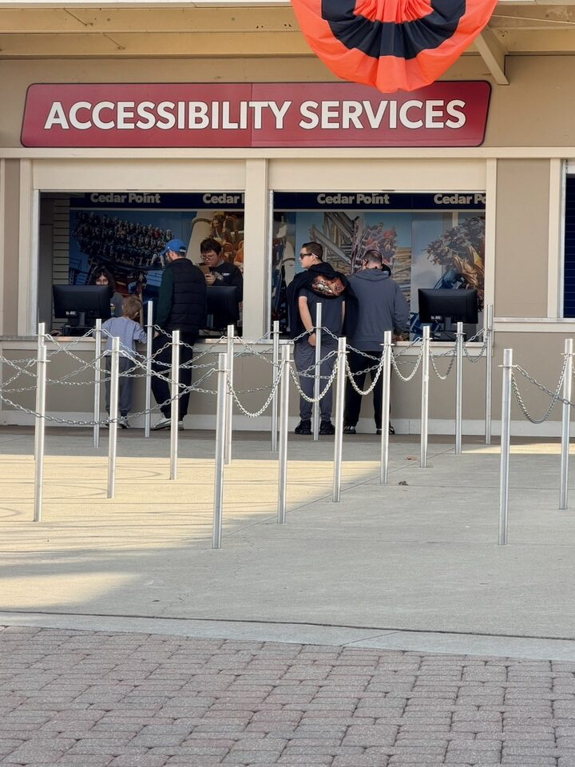
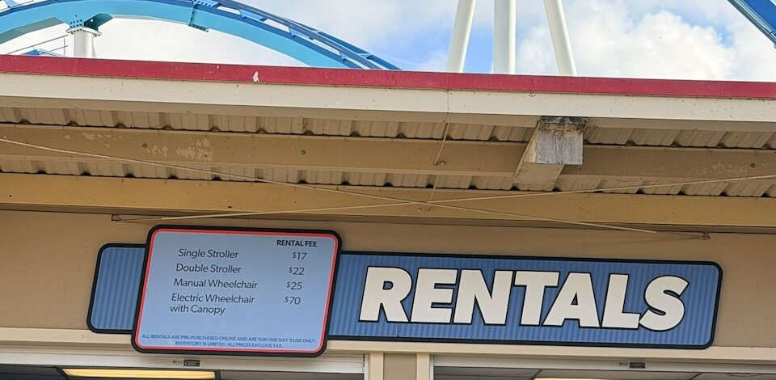

Cedar Point in Sandusky is about 2 hours 45 minutes from Waynesville, and it's one of the better-prepared big parks in the region for guests with disabilities. This guide is for wheelchair and scooter users, guests with autism or other cognitive disabilities who can't wait in a regular line, families with a service dog, and anyone managing medication or medical equipment for the day.

It covers **parking and the entrance**, **getting around**, **skipping the regular line**, **rides and wheelchairs**, **rentals**, **sensory breaks**, **restrooms, food and medical needs**, **service animals**, and **hearing and vision**. It's based on Cedar Point's 2026 Guest Accessibility Guide and my own visit in my power wheelchair.

## Parking and the entrance

Accessible parking is to the right of the main entrance, first come, first served, with car and van-accessible spaces. The lot is smaller than the one at Kings Island, but it's paved and an easy roll to the front gate. Ask the attendant at the toll booth if you're not sure where to go. If the accessible area is full, your party can be dropped off at the pick-up and drop-off area by the main entrance. Keep your placard or plate displayed the whole time; security tickets and tows cars without one.

At the entrance, wheelchair users have a separate line through the metal detectors and bag check, so you don't have to squeeze through the main lanes.

## Getting around

Rolling around is easy. Curb cuts almost always run the full width of the curb, not just a narrow ramp at one spot, so you rarely have to hunt for a way up or down.

Finding your way is another story. Cedar Point opened in 1870, about 100 years before Kings Island, and it grew piece by piece along the peninsula instead of being laid out hub-and-spoke from a central plaza. Paths don't always lead where you expect, so keep the park map or app handy and plan your route between the rides you care about.

## Skipping the regular line

If a mobility restriction or cognitive disability means you can't wait in a regular queue, Cedar Point's Attraction Accessibility Program is for you. The park encourages you to get the **IBCCES Accessibility Card** first: register at [accessibilitycard.org](https://www.accessibilitycard.org/) or in the Accessibility Card app and upload your documentation. Only IBCCES issues the card, not the park.

When you arrive, take your card to the **Accessibility Services counter just inside the park, on the right, next to scooter rental**. It's a separate counter from Guest Services, so you don't have to wait in that line.

Check-in took me about 10 minutes: they looked at my card and asked a couple of questions about whether I could meet the rides' physical requirements. You get a **white paper pass** (Kings Island uses a green card), and up to **four people total**, including you, enter rides through the **exit lane**.

There's **no ticket discount for companions or caregivers**, so everyone in your group needs a ticket or pass.

## Rides and wheelchairs

The park says almost every ride is wheelchair accessible, but on nearly all of them you'll need to **transfer from your chair to the ride seat**. The only ride you can stay in your wheelchair for is the Cedar Point & Lake Erie Railroad, and it's the best ride in the park for chair users.

- **Wheelchair lifts** up to second-story platforms at Corkscrew, GateKeeper, Gemini, Iron Dragon, Wilderness Run, Magnum XL-200, Mine Ride, Pipe Scream, Raptor, Rougarou, Siren's Curse and Steel Vengeance. Each lift has a phone at the base; call, and an associate comes to run it. Maverick and Valravn have self-service elevators. If your scooter has a canopy or other attachments, you may need to switch to a manual wheelchair for the lift.
- **Transfer devices** on request at Blue Streak, Cedar Creek Mine Ride, Corkscrew, GateKeeper, Gemini, Iron Dragon, Magnum XL-200, Top Thrill 2, Valravn, Wilderness Run and Woodstock Express.
- **Ride vehicles with removable sides or wider entry** at Giant Wheel, Pipe Scream, Steel Vengeance, Top Thrill 2 and Wild Mouse. Ask the ride attendant for that car.
- **Body harnesses** on request at GateKeeper, Raptor, Rougarou and Valravn, and **hand controls** at Cadillac Cars.

The important caveat: **Cedar Point staff aren't trained or allowed to lift you out of your chair.** Bring someone who can help you transfer. Prosthetics have their own restrictions on several coasters; check the prosthetics page of the park's accessibility guide before you go.

## Rentals and charging

Wheelchairs, electric scooters (ECVs) and strollers rent at the front gate rental counter just inside the main gate, and wheelchairs also at the CP Corner Store near the Magnum gate.

**Book online before you go.** The sign at the counter says all rentals are pre-purchased online, are for one day only, and inventory is limited. Prices posted there in 2026: manual wheelchair $25, electric wheelchair with canopy $70, single stroller $17, double stroller $22, plus tax. Reserve at [sixflags.com/cedarpoint/rentals](https://www.sixflags.com/cedarpoint/rentals). The counter has a lowered section, and staff help is available on request.

Rentals can't go out to the parking lot, but an associate will help you at the gate. You can **recharge your own wheelchair battery at Guest Services**.

## Sensory breaks

According to the park, there's a **Quiet Room at Frontier Town First Aid** for anyone who needs a break from noise and crowds, with sensory features to use. I didn't see it myself, so ask at First Aid. The Rider Swap program lets one adult wait with someone who won't ride while the rest of the group rides, then swap without lining up again.

**HalloWeekends** (fall weekends) is a real sensory challenge after dark, and the haunted mazes are the most intense part. Everything stays wheelchair accessible, but if anyone in your group is sensitive to noise or surprises, plan to leave or head for a quieter area before the scare zones open.

## Restrooms, food and medical needs

- **Companion restrooms** at Main First Aid, Camp Snoopy, Lakeside Pavilion, Frontier Town First Aid, Sky Ride West and The Barnyard restroom on the Frontier Trail. That's not every restroom area, so note the nearest one. They're small, and **there are no adult changing tables**, unlike Kings Island. Every restroom has wheelchair-accessible stalls.
- **Two First Aid stations**, behind Peanuts @ The Point and in Frontier Town, staffed all day. They'll **store medical equipment and refrigerate medication**, and have space for nursing parents.
- **Food:** getting food was fine from a chair. The one problem was the **Coca-Cola Freestyle drink machines**: the touchscreen menu sits high and can be hard to reach from a seated position, so you may need a companion or an associate to make your selection.
- **Outside food isn't allowed**, but if you need special food for a diet or medical condition, you can bring a small cooler. Stop at Guest Services.

## Service animals

Trained service dogs are welcome, up to two per guest; emotional support animals aren't. On most rides your dog has to stay with someone in your group who isn't riding (use Rider Swap). Dogs can ride the railroad, 4x4's, Cadillac Cars, Camp Bus, Giant Wheel, both carousels, Peanuts Road Rally, Sky Ride, Snoopy's Deep Sea Divers and Snoopy's Express Railroad, sitting on the floor. Relief areas are on the main midway near the Sky Ride West restroom and on the Gemini Midway across from Camp Snoopy.

## Hearing and vision

**ASL interpreters** for live shows with at least seven days' notice, through the request form on the park's accessibility page; show scripts are available at each venue. **Braille and large-print** park guides are at Guest Services, while they last.

## My take

Cedar Point is easy to roll around in a wheelchair: paved paths, full-width curb cuts, a separate entrance line and lifts on the big coasters. Finding your way is harder, because the old layout can be confusing. The biggest challenge is the same as at most theme parks, sensory overload, and during HalloWeekends the haunted mazes are the most intense part. Plan breaks, and skip the mazes if noise and surprises are hard for anyone in your group. The first thing to do when you arrive: go straight to the **Accessibility Services counter** just inside the gate, on the right, so your pass is ready before the lines build.

Official page: [Cedar Point accessibility](https://www.sixflags.com/cedarpoint/accessibility), which links to the Guest Accessibility Guide. More guides like this: [Accessibility guides](../guides.html).
